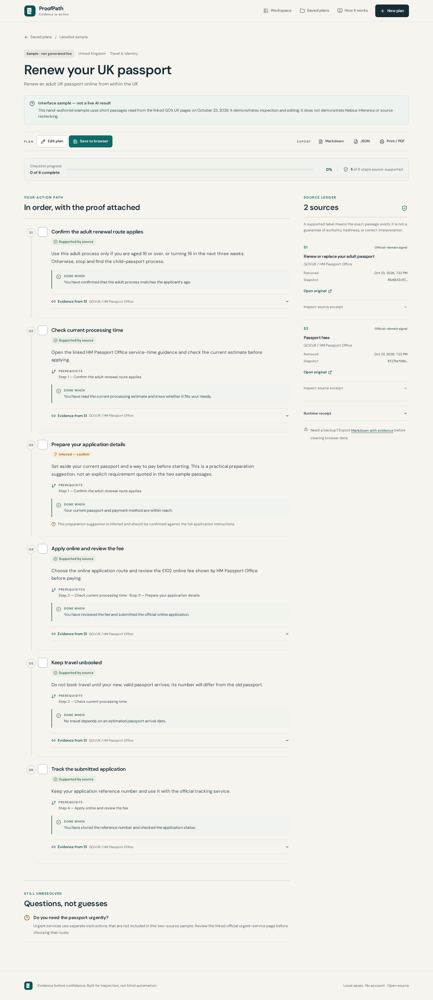

# ProofPath — Evidence-to-Action Engine

**Track: Best Apps and Agents · Nebius Global AI Hackathon**

ProofPath turns a concrete administrative task and official source passages into an ordered, editable checklist. NVIDIA Nemotron proposes the plan through Nebius Token Factory; deterministic code—not the model—decides whether a “supported” label has an exact passage behind it.



> **Current verification status:** the application builds and its deterministic/browser tests pass in this workspace. No genuine Nebius or Tavily call has been observed because credentials are unavailable. The included sample is explicitly static and does **not** establish hackathon runtime compliance. Do not describe this repository as submission-ready until `npm run verify:live` and a real deployed workflow succeed.

**Public static/sample demo:** <https://proofpath-woad.vercel.app>. See [deployment evidence](docs/DEPLOYMENT.md) for the exact deployed commit and hosted checks.

## Why this is not another chatbot

- **Action, not a summary:** ordered instructions, prerequisites, observable completion criteria, progress, editing, and export.
- **Receipts, not confidence theater:** each supported step links to an exact source passage, publisher, URL, retrieval time, and content hash.
- **Visible uncertainty:** supported, inferred/confirm, conflicting, and unable-to-verify remain different states.
- **A model with a referee:** malformed output, invented quotes, unsupported dates, one-source “conflicts,” and dependency cycles are rejected or downgraded by code.
- **Explicit rechecking:** sources are never silently monitored. A user-requested recheck compares availability and normalized content hashes.

## Product boundary

ProofPath helps people inspect and complete administrative processes. It does not determine legal eligibility, provide legal advice, submit applications, book travel, synchronize government accounts, or guarantee that a source is current. It supports public HTML/plain-text URLs and `.txt`/`.md` uploads; PDF and image extraction are not implemented.

## Quick start

### Prerequisite

- Node.js **20.19+** (Node 22 LTS recommended)
- A Nebius Token Factory credential for live inference; no local GPU or Docker
- Optional Tavily credential for source discovery; direct source URLs work without it

### Windows PowerShell

```powershell
git clone --branch arena/38ba6a7c-weatherpact --single-branch https://github.com/timmyspurs12/WeatherPact.git
cd WeatherPact
npm ci
Copy-Item .env.example .env
# Add NEBIUS_API_KEY to .env using a local editor. Never commit it.
npm run dev
```

Open `http://localhost:5173`. The browser uses relative `/api` URLs; Vite proxies them to the local Express server on port 3000.

### macOS / Linux

```bash
git clone --branch arena/38ba6a7c-weatherpact --single-branch https://github.com/timmyspurs12/WeatherPact.git
cd WeatherPact
npm ci
cp .env.example .env
# Add NEBIUS_API_KEY to .env using a local editor.
npm run dev
```

**No credential?** You can still inspect the labelled sample, editing, completion, local saves, exports, and failure behavior. Real intake/plan requests return `LIVE_INFERENCE_UNAVAILABLE`; the app does not fabricate an offline success.

## Try the central workflow

1. Choose **Fill a real UK passport task**. This supplies a real task and two GOV.UK URLs; it does not supply a fake result.
2. Choose **Find my next steps**. Nebius performs intake, asks only essential clarifications, then the server retrieves sources and requests a structured plan.
3. Open evidence passages and the source ledger. Review inferred steps and unresolved questions rather than treating every sentence as a requirement.
4. Edit a factual instruction: its automatic supported status is withdrawn and becomes **Inferred — confirm**.
5. Check steps, explicitly save to the browser, and reload. Export Markdown/JSON for portability.
6. On a live plan, choose **Recheck sources now** to detect unavailable or changed text. Rechecking does not silently rewrite the plan.

The separate **Explore a labelled sample** path uses hand-authored passages read from GOV.UK on 2026-10-23. It never claims a Nebius response.

## Configuration

All credentials are server-only. Never expose them with a `VITE_` prefix.

| Variable               | Required           | Default / purpose                                                                            |
| ---------------------- | ------------------ | -------------------------------------------------------------------------------------------- |
| `NEBIUS_API_KEY`       | For live inference | Bearer credential; alias `NEBIUS_TOKEN_FACTORY_API_KEY` is also accepted                     |
| `NEBIUS_BASE_URL`      | No                 | `https://api.tokenfactory.nebius.com/v1`; restricted to official HTTPS Token Factory hosts   |
| `NEBIUS_MODEL`         | No                 | `nvidia/NVIDIA-Nemotron-3-Nano-30B-A3B`; must remain an `nvidia/` model ID                   |
| `TAVILY_API_KEY`       | No                 | Enables basic Tavily discovery; generated answers are disabled and snippets are not evidence |
| `API_PORT` / `PORT`    | No                 | Local Express port, default `3000`                                                           |
| `RATE_LIMIT_WINDOW_MS` | No                 | Best-effort per-instance window, default `60000`                                             |
| `RATE_LIMIT_MAX`       | No                 | Non-GET API requests per window/IP, default `20`                                             |

`.env` and all other environment files except `.env.example` are ignored. The client contains no credential handling.

## Commands

```bash
npm run dev             # Vite + Express with reload
npm run typecheck       # TypeScript, no emit
npm test                # deterministic unit/API/component tests
npm run evaluate        # execute fixtures; write measured evaluation artifacts
npm run build           # typecheck + client build + generated Vercel function bundle
npm run verify:serverless # smoke-test the generated function with plain Node
npm start               # serve dist and /api from one Node process

npx playwright install chromium  # one-time browser install for local E2E
npm run test:e2e        # starts dev servers if needed; includes axe WCAG scans
npm run screenshots     # captures from http://127.0.0.1:3000 by default

npm run verify:live     # OPT-IN: makes genuine Nebius calls; requires a credential
npm audit               # dependency advisory check
```

`PLAYWRIGHT_BASE_URL` can target an existing server. `CHROMIUM_EXECUTABLE_PATH` can select an existing Chromium binary. Run `npm run evaluate` before `npm run build` so the current measured artifact is included in `public/evaluation.json` and the About page.

## Evidence semantics

| State                    | What code establishes                                                            | What it does **not** establish                                                                                |
| ------------------------ | -------------------------------------------------------------------------------- | ------------------------------------------------------------------------------------------------------------- |
| **Supported by source**  | At least one normalized exact contiguous citation exists in the retrieved source | Semantic correctness, authority, freshness, eligibility, or that every part of a long instruction is entailed |
| **Inferred — confirm**   | Practical suggestion, custom/user-edited content, or withdrawn automatic support | That a source imposes the action                                                                              |
| **Conflicting evidence** | A model-flagged conflict has valid passages from at least two sources            | Which source should win; the conflict interpretation still needs review                                       |
| **Unable to verify**     | No valid supporting passage survives                                             | That the statement is false—only that this plan cannot support it                                             |

A date remains only when a validated citation contains the date text. User edits to a title, instruction, or date withdraw automatic supported status. Conflict labels and conflict entries are linked, but the model’s interpretation is not treated as a deterministic fact.

## Architecture and API

- **Client:** React 19, TypeScript, Vite, plain responsive CSS, Lucide icons, self-hosted fonts.
- **Server:** Express 5 + TypeScript, native bounded `fetch`, Cheerio extraction, Zod.
- **AI:** Nebius Token Factory chat completions with JSON Schema requested and Zod enforced.
- **Discovery:** direct/uploaded sources plus optional Tavily basic search; retrieved publisher text is the evidence.
- **Persistence:** up to 20 explicitly saved plans in this browser’s `localStorage`; no account, server plan database, cross-device sync, or ephemeral-filesystem dependency.
- **Deployment:** Vite static output plus an Express catch-all Vercel function; `npm start` supports a single-process Node host.

| Route                      | Purpose                                                              |
| -------------------------- | -------------------------------------------------------------------- |
| `GET /api/health`          | Reports configuration, never claims a verified live call             |
| `POST /api/intake`         | Real Nebius goal/clarification inference                             |
| `POST /api/plans`          | Retrieval + real Nebius plan inference + deterministic evidence gate |
| `POST /api/sources/verify` | Explicit source availability/hash recheck; no model call             |

See [architecture and trust boundaries](docs/ARCHITECTURE.md), [deployment](docs/DEPLOYMENT.md), and [infrastructure notes](docs/ARCHITECTURE.md#provider-controls).

## Privacy and security

- Do not submit identity numbers, passwords, payment details, confidential notices, or medical records.
- Live task details and uploaded text are sent to Nebius. Tavily receives discovery queries only when configured. Saved plans stay in the browser unless exported.
- Token Factory data-retention behavior is governed by the operator’s account settings; `store: false` is not presented as a Zero Data Retention guarantee.
- Source retrieval enforces HTTP(S)-only URLs, public-address checks on every redirect, an 8-second timeout, 750 KB response cap, supported content types, six-source/30 KB-per-source limits, and bounded extraction. DNS checks reduce SSRF risk but are not a guarantee against every DNS-rebinding technique.
- Provider credentials never enter browser bundles or logs. Logs record operational metadata, not task/source content.
- Browser saves are not encrypted. Export important plans and avoid relying on shared-device storage.

## Measured quality evidence

At the documented local run: **41/41 unit/API/component tests**, **12/12 real Chromium E2E tests**, and **12/12 evaluation cases** passed; the production build succeeded and `npm audit` reported zero vulnerabilities. Axe scans with WCAG 2.2 AA tags returned no violations on the tested desktop/mobile routes and confirmation dialog. Home, Plan, About, and Saved passed horizontal-overflow checks at **1440, 1280, 1024, 768, 390, and 320 px**. These statements are scoped to [the final test report](docs/TEST_REPORT.md), not a promise about every environment or complete WCAG conformance.

The [evaluation report](docs/EVALUATION.md) defines citation coverage, unsupported-claim rejection, conflicts, missing information, workflow completion, provider failures, and fixture latency. It is intentionally adversarial and small; it is not a Nemotron accuracy benchmark.

## Documentation and submission artifacts

- [Official requirements and access check](docs/research/OFFICIAL_REQUIREMENTS.md)
- [Nine-concept weighted scorecard](docs/research/IDEA_SCORECARD.md)
- [Selection ADR](docs/decisions/0001-select-proofpath.md)
- [Evaluation methods/results](docs/EVALUATION.md) · [case ledger](docs/evaluation/cases.json)
- [Test report](docs/TEST_REPORT.md) · [compliance matrix](docs/COMPLIANCE.md)
- [2:45 demo script/storyboard](docs/DEMO_SCRIPT.md) · [screenshots](docs/screenshots/README.md)
- [Devpost draft](docs/DEVPOST_DRAFT.md) · [final A–J handoff](docs/FINAL_REPORT.md)

## Repository note and license

ProofPath is a new application built in the existing WeatherPact repository. The unrelated 64-file WeatherPact source is preserved under `legacy/weatherpact/` and at commit `cde3ec2e2637accaf8db1656237721820ef1b564`; it is not a ProofPath feature or hackathon runtime.

Released under the [MIT License](LICENSE). NVIDIA model weights remain subject to their own model license; this repository’s MIT license does not relicense them.
